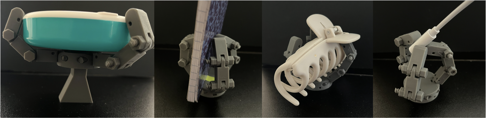

# BiRH — Morphology Lab

A computational research platform for **robotic hand morphology optimization**, built on
MuJoCo.

Bio-inspired Robotic Hand (BiRH) began as a personal project asking: *how is the human hand
so effective at grasping a wide range of objects, and how can we design a robotic hand that
is simpler but still effective?* It evolved through thought experiments, MuJoCo
simulations, 3D-printed prototypes, and conversations with researchers in dexterous
manipulation.

This repository is now the software that turns that question into an answerable one:

> Given a constrained number of fingers, what morphology produces the best grasping
> capability across everyday objects while minimizing mechanical complexity?

That is a design-optimization question, so the software is a laboratory rather than a
simulator: hands are *generated* from a parameter space, evaluated headlessly at thousands
of trials per minute, and compared with real statistics.

The earlier project's review is in [`docs/00-REVIEW.md`](docs/00-REVIEW.md). The original
CAD, prototypes and test photos remain in [`design/`](design/) and
[`visuals/`](visuals/); the hand-authored models in [`simulation/`](simulation/) are kept
as reference and are no longer the source of truth.



---

## Quick start

```bash
pip install -e ".[all]"
morpholab doctor                    # check the environment and render backend
morpholab list                      # every registered component

morpholab morphology show birh_v1 --render hand.png
morpholab run --hand birh_v1 --object mug --task lift --robustness
morpholab sweep configs/studies/02-ablation.yaml -j 20
morpholab analyze runs/02-ablation/<run> --pareto --compare --failures
morpholab optimize morphology --algorithm cmaes --generations 30 -j 20
morpholab optimize policy --hand birh_v1 --objects quick -j 20
python -m morpholab.feasibility birh_v1 --matrix
```

A single trial costs ~150 ms; a 15-object sweep across 9 hands runs in about 5 seconds on
20 cores.

---

## What it does

**Morphology is data.** A hand is a `HandSpec` — palm, digits, mounts, joints, actuation —
that hashes to a stable id and compiles to MuJoCo XML. Nothing downstream hardcodes a
digit count or a joint name.

```python
from morpholab.morphology import get_space, build_hand
space = get_space("three_finger_v1")          # 12 parameters
hand  = space.decode(x)                        # x in [0,1]^12
model = build_hand(hand).compile()
```

The generator uses **one rotation per digit** — a mount frame — after which every phalanx
is expressed in trivial local coordinates. That is what makes the geometry checkable
instead of a field of per-part trigonometry.

**Search spaces quotient out symmetry.** A 3-finger layout has six equivalent encodings;
canonicalization maps them to one, so an optimizer does not spend five evaluations in six
rediscovering the same hand.

**Approach is planned, not assumed.** A fixed standoff would compare a 15 cm-fingered hand
against a 7 cm one at completely different grasp geometries. The planner traces the
fingertip through flexion and places the palm where the digits actually converge on the
object — including pre-closing the digits so their arc clears the table.

**Underactuation is modelled.** `fixed` tendons with per-joint moment arms reproduce the
physical prototype's one-motor-per-finger design, including the proximal-first closure the
original design notes describe achieving with differential screw friction.

**Evaluation is graded, not binary.** Ferrari–Canny ε, grasp-wrench-space volume, grasp
isotropy, contact spread and opposition, disturbance tolerance by constant-wrench
bisection, energy, peak torque, joint utilization — and a mechanical complexity cost model,
because "simpler but effective" needs simplicity to be a number.

**Failures are data.** Every failed trial gets exactly one label from a mutually exclusive
taxonomy (`no_contact`, `insufficient_digits`, `slip_out`, `rotate_out`, `eject_on_lift`,
`self_collision`, `actuator_saturation`, `disturbance_failure`, `unreachable`,
`sim_divergence`), so failure fractions sum to `1 − success rate` and point at a design
change.

**Statistics are done properly.** Wilson intervals for proportions, bootstrap resampled at
the object level, paired tests where the design is paired, Holm correction, effect sizes
beside every p-value, and a power calculator to size a sweep before running it.

**Runs are reproducible.** Seeds derive from job content, so results are identical across
worker counts; a killed sweep resumes as a set difference; every run records its git SHA,
dirty state, package versions and resolved config.

---

## Layout

```
morpholab/
  core/         registry, seeding, content ids, config, paths, logging
  mjcf/         declarative MJCF trees, transforms, compilation
  morphology/   HandSpec, builder, parameter space, presets, validation
  objects/      object specs, library, named sets, MJCF generation
  tasks/        trial scripts, wrist motions, success criteria
  control/      controller interface and closure policies
  sim/          scene assembly, approach planning, rollout, traces, perturbations
  metrics/      grasp quality, contacts, effort, complexity, robustness
  experiments/  jobs, sweeps, parallel runner, result store
  analysis/     intervals, significance, ablations, Pareto fronts
  viz/          offscreen rendering, video, comparison
  optimize/     random / ES / CMA-ES / GA / NSGA-II over a ParamSpace, checkpointed
  rl/           policy controller, ES policy training, Gymnasium env, co-design
  feasibility/  material x actuator manufacturability checks
docs/           review, architecture, mathematics, roadmap, status, design space, optimization
configs/        base settings, study configs, the overnight exploration
tests/          ~290 tests
```

Dependencies run one way: `core → mjcf → {morphology, objects} → {control, tasks} → sim →
metrics → experiments → {analysis, viz}`. Nothing imports upward, and no module imports a
renderer at module scope — headless is the default.

---

## Documentation

| Document | Contents |
|---|---|
| [`docs/00-REVIEW.md`](docs/00-REVIEW.md) | Review of the original project, and the research agenda that follows from it |
| [`docs/01-ARCHITECTURE.md`](docs/01-ARCHITECTURE.md) | Layers, data model, extension points |
| [`docs/02-MATH.md`](docs/02-MATH.md) | Every formula the platform computes, stated precisely |
| [`docs/03-ROADMAP.md`](docs/03-ROADMAP.md) | Phased implementation plan |
| [`docs/04-STATUS.md`](docs/04-STATUS.md) | **What is built, what is not, and what the limits are** |
| [`docs/05-DESIGN-SPACE.md`](docs/05-DESIGN-SPACE.md) | Literature review: which parameters make a hand different in kind, and a proposed second space |
| [`docs/06-OPTIMIZATION-AND-RL.md`](docs/06-OPTIMIZATION-AND-RL.md) | Morphology optimization, ES policy training, co-design, feasibility |

---

## Adding things

| To add… | You write | And touch nothing else |
|---|---|---|
| An object | a function returning an `ObjectSpec` | ✔ |
| A task | a `Task` with stages and criteria | ✔ |
| A controller | `reset` / `act` | ✔ |
| A metric | a function with a declared input kind | ✔ |
| A searchable parameter | one `Param` entry | ✔ |

---

## Status

The platform runs end to end: generate → simulate → measure → sweep → analyze → optimize.
Report generation (M9) is **not yet built**, the simulator has passed a first
timestep-convergence check but is **not calibrated against hardware**, and the approach
planner handles symmetric hands considerably better than opposed ones. [`docs/04-STATUS.md`](docs/04-STATUS.md) states each limitation and what
it bounds — read it before drawing conclusions from a number this platform produced.

## License

MIT — see [LICENSE](LICENSE).
